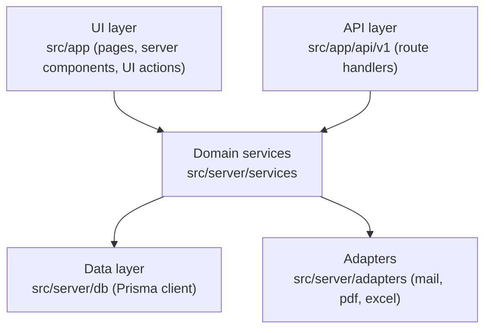
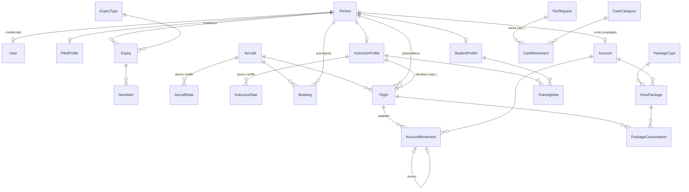
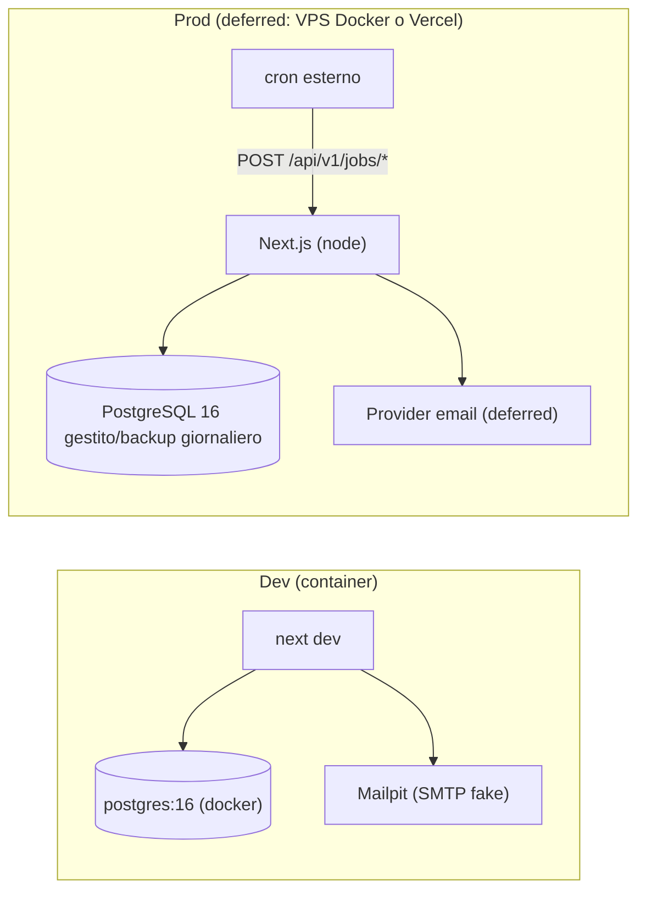

# Architecture Spine — AirManager

## Design Paradigm

**Monolite Next.js a strati.** Tre strati con dipendenze a senso unico:



- `src/app` (pagine e route handler) è **sottile**: valida input, chiama un service, presenta il risultato. Zero logica di dominio, zero Prisma.
- `src/server/services/*` contiene tutta la logica di dominio; è l'unico strato che tocca Prisma.
- Le dipendenze puntano solo verso il basso; i services non importano mai nulla da `src/app`.

## Invariants & Rules

### AD-1 — Ogni mutazione passa dalle API REST versionate
- **Binds:** all (in particolare FR-42, NFR-2)
- **Prevents:** funzionalità solo-web inutilizzabili dal futuro client Flutter; doppia logica UI/API.
- **Rule:** ogni scrittura avviene via `POST/PUT/PATCH/DELETE /api/v1/...` (route handler → Zod → service). Le pagine web chiamano le stesse API (o server actions che delegano allo *stesso* service delle API, mai a logica propria). Gli schemi Zod sono registrati nel registry OpenAPI; la spec è servita da `GET /api/v1/openapi.json`.

### AD-2 — Denaro in centesimi, tempo in minuti (interi)
- **Binds:** FR-10..FR-16, FR-25..FR-31 (tariffe, voli, conti, cassa)
- **Prevents:** errori di arrotondamento e schemi incompatibili tra moduli finanziari.
- **Rule:** ogni importo è `Int` in centesimi di euro; ogni durata di volo è `Int` in minuti. Costo volo = `round(rate_cents * minutes / 60)` (half-up, al centesimo). Nessun `Float`/`Decimal` monetario; la formattazione è solo presentazione.

### AD-3 — Ledger append-only con storno
- **Binds:** FR-15, FR-16, FR-25, FR-28, FR-29, NFR-4
- **Prevents:** due moduli che "correggono" i saldi in modi diversi (update in place vs delete vs riga negativa).
- **Rule:** `AccountMovement` e `CashMovement` non si aggiornano né cancellano mai. Ogni correzione crea un movimento di **storno** (`reversalOfId` → movimento originale) ed eventualmente un nuovo movimento corretto. Il saldo è sempre `SUM(amountCents)` — mai un campo saldo mantenuto a mano.

### AD-4 — Tariffe storicizzate + snapshot sul volo
- **Binds:** FR-10, FR-11, FR-15
- **Prevents:** ricalcoli retroattivi che cambiano addebiti storici quando cambia una tariffa.
- **Rule:** `AircraftRate`/`InstructorRate` hanno `validFrom`; la tariffa in vigore per una data è quella con il massimo `validFrom <= flightDate`. Alla registrazione il Volo salva lo **snapshot** della scomposizione (minuti, rate applicato, minuti scalati da pacchetto, importi) dentro i movimenti generati. Lo storico si legge dagli snapshot, mai ricalcolando.

### AD-5 — RBAC nel service layer
- **Binds:** all (FR-2 in particolare), NFR-3
- **Prevents:** endpoint protetti solo dalla UI; controlli d'accesso divergenti tra moduli.
- **Rule:** ogni funzione di service riceve l'`Actor` (utente + ruoli) e chiama `authorize(actor, permission, resource?)` di `src/server/auth/rbac.ts` prima di agire. La mappa permessi→ruoli vive solo lì. Middleware e UI nascondono la navigazione ma non sono mai l'unico guardiano. Violazione → `ForbiddenError` → HTTP 403.

### AD-6 — Consumo pacchetti deterministico
- **Binds:** FR-12, FR-13, FR-15
- **Prevents:** implementazioni divergenti dell'ordine di consumo e della copertura.
- **Rule:** un Volo idoneo scala minuti dal pacchetto **non esaurito e non scaduto con `purchasedAt` più vecchio**, poi dai successivi; l'eccedenza va a tariffa piena. Il pacchetto copre **solo** il costo velivolo, mai la tariffa istruttore. Il consumo è registrato per-volo (`PackageConsumption`: volo, pacchetto, minuti) per rendere reversibile lo storno (AD-3).

### AD-7 — i18n obbligatoria via next-intl
- **Binds:** all UI + email (NFR-1, FR-22)
- **Prevents:** stringhe hardcoded che rendono impossibile la parità IT/EN.
- **Rule:** routing localizzato `/{locale}` con `locale ∈ {it, en}`; ogni stringa utente (UI, validazioni, email, PDF) passa dai cataloghi `messages/{it,en}.json`. Le email e il form PPR usano la lingua scelta dal destinatario/richiedente.

### AD-8 — Contratto errori e formati API
- **Binds:** all API (FR-42)
- **Prevents:** envelope di errore e formati data incompatibili tra endpoint.
- **Rule:** errori JSON `{ "error": { "code": string, "message": string, "details"?: object } }` con `code` stabile in SCREAMING_SNAKE; validazione fallita → 422 `VALIDATION_ERROR`; non autenticato → 401; vietato → 403; non trovato → 404. Date/ore in ISO 8601 UTC nel wire format (la UI presenta in Europe/Rome); id `cuid` stringa; liste paginate `{ items, total, page, pageSize }`.

### AD-9 — Job schedulati idempotenti via route protette
- **Binds:** FR-27, FR-37
- **Prevents:** alert duplicati e dipendenza da uno scheduler specifico dell'hosting.
- **Rule:** i job (alert scadenze, saldo negativo) sono `POST /api/v1/jobs/*` protetti da bearer token `JOBS_SECRET`, invocati da cron esterno. Idempotenza garantita da tabella `SentAlert` (unique su scadenza/conto + soglia): un alert per soglia, sempre (FR-37).

### AD-10 — Auth.js v5 con credenziali e sessioni JWT `[ADOPTED]`
- **Binds:** FR-1, FR-3, NFR-2
- **Prevents:** doppio sistema di sessione tra web e API.
- **Rule:** autenticazione con Auth.js v5 (Credentials provider, password Argon2id) + `@auth/prisma-adapter`; sessione JWT in cookie per il web e la **stessa** verifica token riusabile dalle API per il client mobile futuro. Utente disattivato → token rifiutato alla verifica (max 15 min di grazia, FR-3).

### AD-11 — Un'unica anagrafica Persona con profili
- **Binds:** FR-4..FR-6, FR-32
- **Prevents:** tre tabelle separate pilota/allievo/istruttore che duplicano la stessa persona.
- **Rule:** `Person` è l'unica anagrafica; `PilotProfile`, `StudentProfile`, `InstructorProfile` sono 1-a-0/1 su `Person`; `Account` (conto prepagato) appartiene a `Person`, non al profilo — il passaggio allievo→pilota non tocca conto né storico. `User` (credenziali) è 1-a-0/1 su `Person`.

## Consistency Conventions

| Concern | Convention |
| --- | --- |
| Lingua codice | Codice, commenti, identificatori, messaggi di commit in inglese; UI/documenti via i18n |
| Naming DB/Prisma | Modelli PascalCase singolari (`Flight`, `AccountMovement`); enum Prisma SCREAMING_SNAKE; campi camelCase |
| Naming file | Componenti React PascalCase; il resto kebab-case; servizi `src/server/services/<domain>.service.ts` |
| API paths | Plurale kebab-case: `/api/v1/flights`, `/api/v1/account-movements`; query di filtro camelCase |
| Validazione | Uno schema Zod per input/output per endpoint in `src/lib/schemas/<domain>.ts` — unica fonte per OpenAPI, route e form |
| UI kit | Tailwind CSS 4 + shadcn/ui; tabelle dati con TanStack Table; form con react-hook-form + zodResolver |
| Stato client | Niente store globale: server components + fetch/mutate via API; stato locale React dove serve |
| Errori nei service | Gerarchia `DomainError` (`NotFoundError`, `ForbiddenError`, `ValidationError`, `ConflictError`) mappata una sola volta in HTTP nel layer API |
| Test | Vitest per services (calcoli, RBAC, pacchetti) con DB Postgres di test; Playwright per i flussi UJ-1..UJ-6; file test accanto al codice `*.test.ts` |
| Export | Ogni endpoint elenco accetta `?format=xlsx`; i PDF hanno route dedicate `/api/v1/**/pdf` |

## Stack

| Name | Version |
| --- | --- |
| TypeScript | 6.0.x |
| Next.js (App Router) | 16.2.x |
| React | 19.2.x |
| Prisma + @prisma/client | 7.8.x |
| PostgreSQL | 16 |
| next-auth (Auth.js) | 5.0.0-beta.31 + @auth/prisma-adapter 2.11.x |
| next-intl | 4.13.x |
| Tailwind CSS | 4.3.x |
| shadcn/ui | latest CLI al momento dello scaffold |
| @tanstack/react-table | 8.21.x |
| zod | 4.4.x |
| @asteasolutions/zod-to-openapi | 8.5.x |
| exceljs | 4.4.x |
| @react-pdf/renderer | 4.5.x |
| Vitest | 4.1.x |
| @playwright/test | 1.61.x |

*(Verificate su npm il 2026-07-04; pin esatti decisi allo scaffold.)*

## Structural Seed

### Source tree

```text
airmanager/
  prisma/
    schema.prisma          # modelli + enum
    seed.ts                # dati demo + tipi scadenza standard
  messages/
    it.json  en.json       # cataloghi next-intl
  src/
    app/
      [locale]/            # UI localizzata
        (auth)/login/
        (dashboard)/       # aree per ruolo: persone, velivoli, voli, prenotazioni,
                           # ppr, finanze, scuola, scadenze, impostazioni
        ppr/               # form PPR pubblico (design-taste-frontend)
      api/v1/              # route handlers REST (+ openapi.json, jobs/)
    server/
      auth/                # auth.ts (Auth.js), rbac.ts (authorize, mappa permessi)
      db/                  # prisma.ts (client singleton)
      services/            # people, aircraft, rates, packages, flights, bookings,
                           # ppr, accounts, cash, school, expiries, exports
      adapters/            # mail/ (MailSender), pdf/, excel/
    lib/
      schemas/             # Zod per dominio (fonte OpenAPI)
      api-client.ts        # fetch tipizzato usato dalla UI
      money.ts  time.ts    # helper centesimi/minuti
  e2e/                     # Playwright
  docker-compose.yml       # postgres 16 + mailpit (dev)
```

### ERD (nomi e relazioni)



### Deployment & environments



Ambienti: `development` (docker-compose: postgres + mailpit), `test` (DB Postgres dedicato per Vitest/Playwright), `production` (deferred — vedi Deferred). Config solo via env var validate a boot in `src/lib/env.ts`.

## Capability → Architecture Map

| Capability / Area | Lives in | Governed by |
| --- | --- | --- |
| Auth, utenti, ruoli (FR-1..3) | `server/auth`, `services/people` | AD-5, AD-10 |
| Anagrafiche persone (FR-4..6) | `services/people` | AD-11 |
| Velivoli (FR-7..9) | `services/aircraft` | AD-2 (contaore in minuti) |
| Tariffe e pacchetti (FR-10..13) | `services/rates`, `services/packages` | AD-2, AD-4, AD-6 |
| Voli (FR-14..17) | `services/flights` | AD-2, AD-3, AD-4, AD-6 |
| Prenotazioni (FR-18..21) | `services/bookings` | AD-5 (blocchi per scadenze via `services/expiries`) |
| PPR (FR-22..24) | `services/ppr`, `app/[locale]/ppr` | AD-7, AD-8, AD-9 (email) |
| Finanze piloti (FR-25..28) | `services/accounts` | AD-2, AD-3 |
| Finanze aviosuperficie (FR-29..31) | `services/cash` | AD-2, AD-3 |
| Scuola volo (FR-32..34) | `services/school` | AD-11 |
| Scadenze (FR-35..38) | `services/expiries` | AD-9 |
| Export (FR-39..40) | `services/exports`, `adapters/excel`, `adapters/pdf` | convenzione Export |
| Dashboard (FR-41) | `app/[locale]/(dashboard)` | AD-1 (read via services) |
| API/OpenAPI (FR-42) | `app/api/v1`, `lib/schemas` | AD-1, AD-8 |

## Deferred

- **Hosting di produzione** (VPS Docker vs Vercel + Postgres gestito): non blocca lo sviluppo; il seed produce Dockerfile + docker-compose. Rivisitare prima del go-live.
- **Provider email di produzione** (Resend / SES / SMTP dell'aviosuperficie): dietro `MailSender` (AD — interfaccia stabile); dev usa Mailpit. Decidere al go-live.
- **Rate limiting infrastrutturale**: per l'MVP basta il rate limit applicativo sul form PPR; una soluzione globale (reverse proxy) è del deployment.
- **Strategia migrazioni in produzione** (prisma migrate deploy in CI): dettaglio della pipeline, si fissa quando esiste la pipeline.
- **Schema dettagliato dei campi**: l'ERD fissa entità e relazioni; i campi vivono in `schema.prisma` (il codice è l'owner) nel rispetto di AD-2/AD-4/AD-11.
